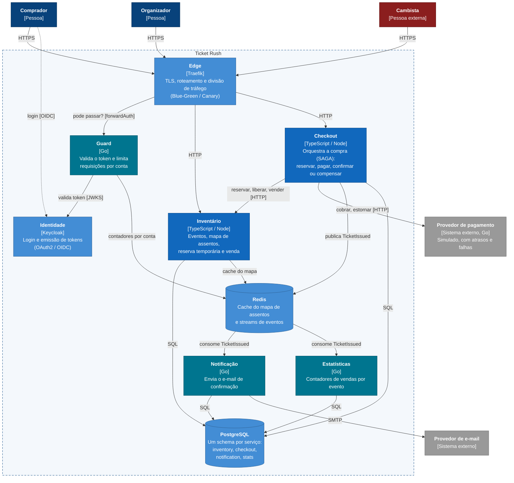

# Ticket Rush

Projeto final de Engenharia de Sistemas Distribuídos (UFPB, 2026.2), Prof. Raoni Kulesza.

Sistema de venda de ingressos com reserva de assentos para aberturas de venda de alta demanda. Milhares de compradores disputam poucos assentos ao mesmo tempo, a compra passa por vários serviços que podem falhar no meio do caminho, e bots de cambistas tentam reservar em massa. O objetivo é que nenhum assento seja vendido duas vezes, que nenhuma reserva fique presa quando um serviço cai, e que os bots sejam contidos sem prejudicar os compradores reais.

A proposta enviada no Projeto 01 está em [`docs/PROPOSTA.md`](docs/PROPOSTA.md).

## Status

| Entrega | Data | Situação |
|---|---|---|
| Projeto 01: definição do grupo e tema | 09/10/2026 | Proposta enviada |
| Projeto 02: documentação inicial (C4, ADRs, stack, setup) | 06/11/2026 | Documentação pronta; setup em andamento |
| Projeto 03: documentação final, código e testes | 11/12/2026 | Pendente |

## Equipe

| Nome | Matrícula | E-mail |
|---|---|---|
| Bruno Almeida dos Santos | 20230013099 | almeidabruno1506@gmail.com |
| Diego de Carvalho Dias | 20230089696 | diegoddias007@gmail.com |
| Johan Carlos Pereira Fernandes | 20230126771 | johancarlos62@gmail.com |
| Luis Antonio Feliciano da Silva | 20230012752 | luis.feliciano@academico.ufpb.br |

## Arquitetura

Seis serviços atrás de um proxy reverso. A compra é coordenada por uma SAGA no Checkout; depois dela, Notificação e Estatísticas reagem a um evento publicado no Redis Streams.



Mais detalhes:
- [C4 nível 1: contexto](docs/architecture/C4-1-CONTEXTO.md)
- [C4 nível 2: containers](docs/architecture/C4-2-CONTAINERS.md), com as decisões e trade-offs deste nível
- [Decisões de arquitetura (ADRs)](docs/adr/README.md)
- [Padrões arquiteturais](docs/PADROES.md)

## Responsabilidades

| Integrante | Linguagem | Responsável por |
|---|---|---|
| Johan Carlos | Go | Plataforma: Traefik, Guard, Keycloak, CI/CD, Blue-Green/Canary, observabilidade; bots de carga |
| Diego de Carvalho Dias | Go | Pagamento (simulado), Notificação, Estatísticas |
| Bruno Almeida dos Santos | TypeScript | Inventário ou Checkout (a definir entre Bruno e Luis) |
| Luis Antonio Feliciano da Silva | TypeScript | Checkout ou Inventário (a definir entre Bruno e Luis) |

## Tecnologias

TypeScript (Node.js) e Go, PostgreSQL, Redis, Traefik, Keycloak, Docker Compose, GitHub Actions, Prometheus, Grafana, Jaeger e k6. A justificativa de cada uma está no [ADR-003](docs/adr/0003-STACK.md).

## Documentação

| Documento | Conteúdo |
|---|---|
| [docs/PROPOSTA.md](docs/PROPOSTA.md) | Proposta do Projeto 01 |
| [docs/architecture/](docs/architecture/) | Diagramas C4 e [evolução da arquitetura](docs/architecture/EVOLUCAO.md) |
| [docs/infra/](docs/infra/COMO-EXECUTAR.md) | Como executar e como funciona cada peça de infraestrutura |
| [docs/adr/](docs/adr/README.md) | Decisões de arquitetura |
| [docs/PADROES.md](docs/PADROES.md) | Padrões aplicados e onde |
| [docs/contracts/](docs/contracts/EVENTOS.md) | Contratos de eventos entre serviços |
| [CONTRIBUTING.md](CONTRIBUTING.md) | Branches, commits e pull requests |
| [CHANGELOG.md](CHANGELOG.md) | Mudanças por versão |

## Como executar

```bash
cp .env.example .env      # depois troque todos os valores change-me
docker compose up -d
```

Instruções completas, endereços e comandos em [docs/infra/COMO-EXECUTAR.md](docs/infra/COMO-EXECUTAR.md).

## Próximos passos

- Contratos HTTP (OpenAPI) de cada serviço, escritos pelo responsável antes do código: Inventário, Checkout e Pagamento. O contrato do evento `TicketIssued` já está em [`docs/contracts/EVENTOS.md`](docs/contracts/EVENTOS.md).
- Esqueleto de cada serviço (Dockerfile e `/health`) entrando no Compose.
- CI com build e lint dos serviços.

## Ferramentas de IA utilizadas

Esta seção é atualizada ao longo do projeto.

| Ferramenta | Onde atuou | Como foi orientada | Avaliação |
|---|---|---|---|
| Claude (Claude Code) | Leitura do enunciado, discussão do tema e redação da proposta do Projeto 01 | O grupo forneceu o PDF do enunciado e discutiu as opções de tema, padrões e tecnologias; as decisões foram tomadas pelo grupo a partir das alternativas apresentadas | A comparação entre temas e a lista de padrões foram úteis. Detalhes técnicos que ele trouxe cedo demais (como o mecanismo de bloqueio do assento) foram adiados para os ADRs do Projeto 02 |
| Claude (Claude Code) | Projeto 02: diagramas C4, redação dos ADRs 001 a 007, lista de padrões, guia de contribuição | As decisões foram discutidas uma por vez, em sessões de perguntas em que a ferramenta apresentava alternativas com prós e contras e uma recomendação; o grupo escolheu cada opção e revisou os textos antes do commit | Ajudou a comparar alternativas e a escrever os trade-offs. Precisou de correção em dois pontos: no ADR-001 propôs mecanismos demais para casos de canto (estados e alertas extras), e o grupo pediu uma versão mais simples que cobrisse os mesmos casos com menos peças; no C4 colocou o limite de assentos por comprador no Guard, que não é dono dos pedidos, e a regra foi movida para o Checkout. O primeiro desenho do C4 nível 1 saiu com rótulos sobrepostos e foi refeito em outro formato |
