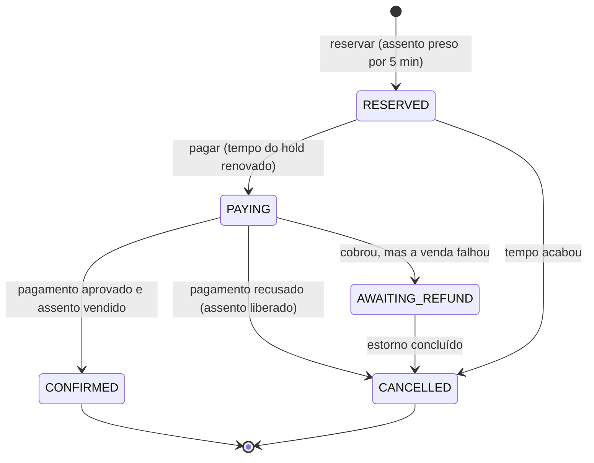

# ADR-001: SAGA híbrida para a compra de ingressos

- **Status:** aceita
- **Data:** 13/10/2026
- **Responsáveis pela implementação:** Checkout (orquestrador), Inventário, Pagamento, Notificação e Estatísticas

## Contexto

Uma compra passa por três serviços com bancos separados: o Inventário segura e vende o assento, o Pagamento (um provedor externo, simulado) cobra o comprador, e o Checkout coordena os dois. Não existe uma transação de banco que cubra os três, então se o pagamento falhar depois que o assento foi segurado, nenhum `ROLLBACK` desfaz a reserva sozinho.

Além disso, a compra tem duas ações do comprador separadas no tempo (reservar e, minutos depois, pagar), e qualquer serviço pode cair no meio do caminho. Como envolve dinheiro, a regra que não pode ser quebrada é: **ao final, nunca existe dinheiro cobrado sem assento vendido.**

Depois que a compra fecha, outros serviços precisam saber dela (Notificação envia o e-mail, Estatísticas atualiza os contadores), mas o comprador não deve esperar por eles.

## Decisão

Usar uma **SAGA**: a compra é dividida em passos locais, cada um com uma ação que o desfaz (compensação), em vez de uma transação única. Ela é **híbrida**:

- **Orquestração na compra.** O Checkout conhece a sequência e comanda cada passo. Cada pedido é uma SAGA, do reservar até o estado final.
- **Coreografia depois da compra.** O Checkout publica o evento `TicketIssued` e quem tiver interesse reage, sem o Checkout saber quem são.

### Estados do pedido

| Estado | Significado |
|---|---|
| `RESERVED` | Assento reservado, esperando o comprador pagar |
| `PAYING` | Cobrança em andamento |
| `CONFIRMED` | Pago e assento vendido |
| `CANCELLED` | Encerrado sem venda; guarda o motivo (expirou, pagamento recusado, venda falhou) |
| `AWAITING_REFUND` | Cobrou, mas a venda falhou; o estorno está pendente |

### Regras

1. **O tempo de 5 minutos é como o servidor percebe que a pessoa saiu.** Fechar a aba ou perder a conexão não avisa nada ao servidor; sem o tempo limite, o assento ficaria preso para sempre. Ao clicar em pagar, o tempo é renovado para o assento não escapar durante o pagamento.
2. **Grava antes de agir.** Toda mudança de estado é salva no Postgres (schema `checkout`) antes de chamar outro serviço.
3. **Repetir é seguro.** A passagem de RESERVED para PAYING é um `UPDATE ... WHERE status = 'RESERVED'`, então um segundo clique em pagar é recusado. Toda cobrança e todo estorno levam o cabeçalho `Idempotency-Key` derivado do ID do pedido; o Pagamento guarda a chave e, ao recebê-la de novo, devolve o resultado da primeira chamada em vez de cobrar outra vez.
4. **Um job de recuperação termina o que ficou pela metade.** Ele procura pedidos parados em PAYING ou AWAITING_REFUND. Para PAYING, primeiro pergunta ao Pagamento se aquele pedido foi pago (consulta pelo ID), e só então confirma ou estorna. Para AWAITING_REFUND, tenta o estorno de novo a cada ciclo até conseguir.
5. **Transactional Outbox para o evento pós-compra.** Na mesma transação que grava CONFIRMED, o Checkout grava o `TicketIssued` na tabela `outbox`. O job publica os eventos pendentes no Redis Streams e marca como enviados. Se cair entre publicar e marcar, o evento sai de novo, então Notificação e Estatísticas ignoram um pedido que já processaram.
6. **DLQ nos consumidores.** Se um consumidor falhar 3 vezes na mesma mensagem, ela vai para um stream de mensagens mortas, para análise.

### Casos com dinheiro

| Situação | O que acontece |
|---|---|
| Comprador sumiu | O tempo acaba e o assento volta; não houve cobrança |
| Pagamento recusado | Assento liberado na hora; não houve cobrança |
| Checkout caiu logo depois de cobrar | O job pergunta ao Pagamento e termina a venda ou estorna |
| Clique duplo ou retry | A chave de idempotência impede a segunda cobrança |
| Estorno com o Pagamento fora do ar | O job repete até conseguir; a chave garante que devolve uma vez só |

## Alternativas consideradas

- **Transação distribuída (two-phase commit).** Exigiria que o provedor de pagamento participasse da nossa transação, o que um gateway de cartão real não faz. Também trava recursos enquanto espera todos responderem.
- **SAGA só por coreografia.** Cada serviço reagiria a eventos dos outros, sem coordenador. Com três passos e compensação, o fluxo ficaria espalhado pelos serviços e seria difícil responder "por que esse pedido parou aqui?".
- **SAGA só a partir do pagar.** O reservar seria uma chamada direta ao Inventário. Entre reservar e pagar ninguém seria dono do pedido, e não teríamos o histórico de reservas que expiraram.
- **Motor de workflow pronto (Temporal).** Faz a persistência e a retomada sozinho, mas é mais um sistema pesado na VPS e esconde o mecanismo que o projeto quer mostrar.

## Consequências

**Positivas**
- A regra "nunca dinheiro cobrado sem assento vendido" é garantida pelos estados, pela chave de idempotência e pelo job, sem depender de nenhum serviço ficar de pé.
- Todo pedido tem histórico completo. Pedidos cancelados por expiração, por comprador, viram um sinal de cambista.
- Notificação e Estatísticas podem cair sem afetar a compra.

**Negativas e riscos aceitos**
- **Consistência eventual.** Entre os passos, os serviços podem discordar por alguns instantes (o assento aparece segurado enquanto o pagamento ainda não respondeu). Uma compensação desfaz o efeito, mas não apaga que ele aconteceu.
- **Estorno depende do provedor.** Se o Pagamento ficar fora do ar por horas, o estorno espera por ele. Para isso não ficar em silêncio, o Grafana mostra "pedidos aguardando estorno há mais de 10 minutos".
- **Mais código que uma chamada simples:** máquina de estados, tabela `outbox`, job de recuperação e consumidores que ignoram repetição.
- **Contrato com o Pagamento:** ele precisa aceitar `Idempotency-Key` e expor a consulta de pagamento pelo ID do pedido.

## Como validar

- Derrubar o Checkout (`docker kill`) durante o teste de carga: todo pedido deve terminar CONFIRMED ou CANCELLED, sem cobrança duplicada.
- Configurar o Pagamento para recusar 20% das cobranças: nenhum assento deve ficar preso.
- Derrubar o Pagamento enquanto há estornos pendentes e subir de novo: todos devem ser concluídos.
- Enviar o mesmo pagamento duas vezes: uma cobrança só.
