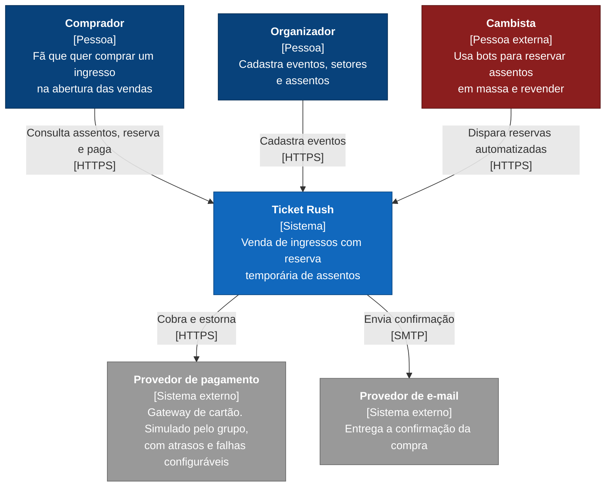

# C4 nível 1: contexto

O sistema visto de fora, como uma caixa só. Mostra quem usa o Ticket Rush e com quais sistemas externos ele conversa.

## Decisões deste nível

- **O cambista aparece como ator, em vermelho.** Ele é parte do problema que o sistema resolve, então o diagrama mostra o adversário. Rate limit e mitigação de bots existem por causa dele.
- **O pagamento é um sistema externo.** Na vida real seria um gateway de cartão de terceiros. No projeto, o grupo escreve um simulador que atrasa, falha e cai de propósito, mas ele fica fora da fronteira do Ticket Rush. O sistema só fala com ele por HTTP, como falaria com um provedor real.
- **O e-mail também é externo.** Em desenvolvimento ele é substituído por um servidor SMTP de teste.
- Login (Keycloak) e infraestrutura (Postgres, Redis, observabilidade) ficam dentro da caixa e só aparecem no nível 2.
