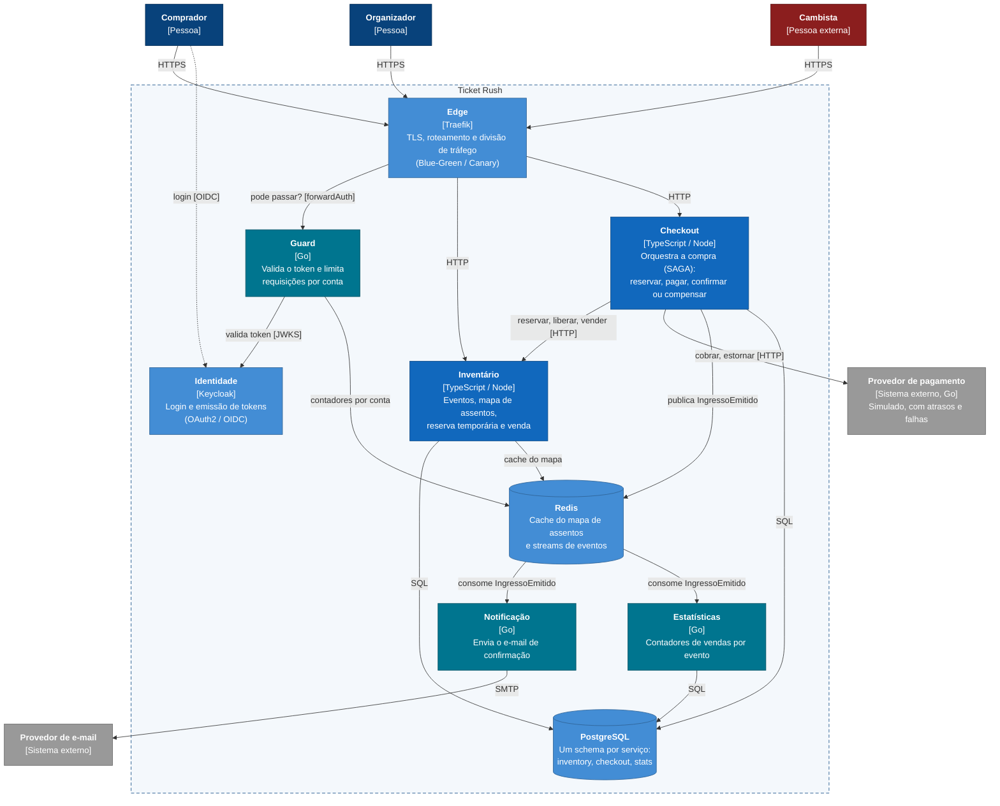

# C4 nível 2: containers

Abre a caixa do Ticket Rush e mostra os serviços, bancos e filas que existem dentro dela, quem fala com quem e por qual protocolo.

Fora do diagrama, para não poluir: todos os containers exportam métricas para o **Prometheus** e traces para o **Jaeger**, e os painéis ficam no **Grafana**. Os **bots** de carga também não aparecem, porque do ponto de vista do sistema eles são os atores Comprador e Cambista, rodando de outra máquina.

## Containers e donos

| Container | Linguagem | Dado que possui | Responsável |
|---|---|---|---|
| Edge | Traefik (pronto) | nenhum (configuração por labels) | Johan |
| Guard | Go | nenhum (contadores por conta no Redis) | Johan |
| Identidade | Keycloak (pronto) | usuários e credenciais | Johan |
| Inventário | TypeScript | schema `inventory`: eventos, assentos, holds | Bruno ou Luis |
| Checkout | TypeScript | schema `checkout`: pedidos e estado da SAGA | Luis ou Bruno |
| Pagamento (externo) | Go | transações simuladas | Diego |
| Notificação | Go | nenhum persistente | Diego |
| Estatísticas | Go | schema `stats`: contadores de vendas | Diego |

## Decisões deste nível

Cada decisão com a alternativa considerada e o preço aceito. As que pesam mais viram ADR.

- **Um Postgres, um schema por serviço.** Cada serviço tem o seu schema e o seu usuário, sem permissão nos outros; quando o Checkout precisa de um assento, ele pede ao Inventário por HTTP. Isso torna a queda de um serviço uma falha real e testável. Alternativas: banco compartilhado (acopla os serviços pelo banco) e uma instância por serviço (isolamento físico, mas três bancos para operar na VPS). Preço aceito: se a instância cair, caem todos, e uma query pesada de um serviço pode deixar os outros lentos. Se os testes de carga mostrarem isso, o Inventário ganha uma instância própria, o que é só trocar a string de conexão.
- **Checkout → Inventário síncrono (HTTP).** O comprador precisa saber na hora se conseguiu o assento. Preço aceito: acoplamento temporal, porque se o Inventário estiver lento, o Checkout fica lento junto. Isso é mitigado com timeout, Circuit Breaker no Checkout e o cache no Inventário. Regra usada: síncrono quando alguém espera a resposta para decidir, assíncrono quando é só avisar que algo aconteceu.
- **Pós-compra assíncrono, via Redis Streams.** Ninguém deve esperar o e-mail para ver a compra confirmada. Redis Streams tem consumer groups e ack, e o Redis já está no projeto. Alternativas: RabbitMQ (DLQ e retry nativos, mas mais uma peça) e Kafka (pesado demais para o volume e para a VPS). Preço aceito: a DLQ é implementada pelo grupo (após N falhas, a mensagem vai para outro stream).
- **Redis com três papéis (cache, contadores do Guard e streams).** Uma peça só para operar, e todos os usos combinam com dado em memória com expiração. Preço aceito: o Redis vira ponto único de falha. Sem ele, o mapa de assentos fica mais lento (lê direto do Postgres), o Guard precisa decidir entre deixar passar ou bloquear (fail-open ou fail-closed) e os eventos pós-compra param. Isso vira um teste de resiliência: derrubar o Redis durante a carga e medir.
- **Edge pronto (Traefik) + Guard próprio (Go).** O Traefik faz o trabalho genérico: TLS, roteamento e divisão de tráfego por peso, que é o que o Blue-Green e o Canary precisam. Antes de encaminhar cada requisição de compra, ele consulta o Guard (`forwardAuth`), que valida o token e limita as requisições por conta em vez de por IP, o que pega o cambista que usa muitos IPs. O limite de assentos por comprador fica no Checkout, dono dos pedidos (ver ADR-002). Alternativas: gateway inteiro em Go (reimplementa TLS, roteamento e canary), só Traefik (rate limit genérico, não entende o que é um comprador) e Kong (mais pesado, também sem lógica de domínio). Preço aceito: um salto de rede a mais por requisição, medido no Jaeger, e o Guard vira peça crítica para comprar; se ele cair, a compra é bloqueada (fail-closed), mitigado com duas réplicas, e a consulta de assentos continua porque não passa por ele.
- **Inventário e Checkout não ficam expostos.** Só o Traefik recebe tráfego de fora, então o token e o rate limit valem para todo mundo, inclusive para o cambista.
- **Keycloak em vez de um serviço de login próprio**, para ter OAuth2/OIDC real sem escrever código de autenticação.
- Em aberto para ADR: se o evento `IngressoEmitido` sai por Transactional Outbox, e se o controle do hold fica no Postgres ou no Redis.
