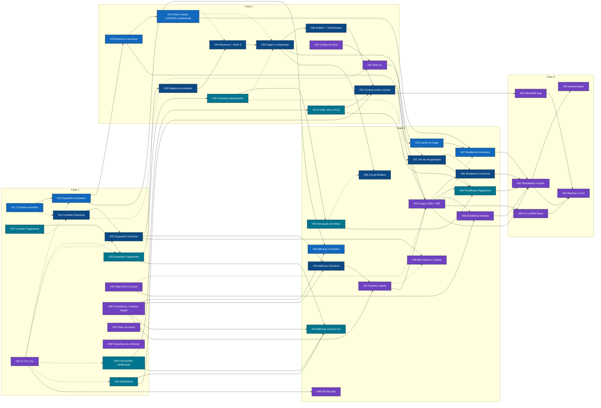

# Tarefas do Projeto 03

Mapa das tarefas até a entrega final de **11/12/2026**. O detalhe de cada tarefa (o que fazer, de quem depende, como testar, o que documentar) está na issue; aqui fica a visão de conjunto: quem faz o quê, o que trava o quê e o que já dá para começar.

O status de cada tarefa fica só na issue e no quadro, para não haver dois lugares dizendo coisas diferentes.

| Onde | Para quê |
|---|---|
| [Quadro do projeto](https://github.com/users/johancarloss/projects/1) | Colunas Bloqueada, Pronta, Em andamento, Em revisão e Feita, com o campo Fase |
| [Milestone Projeto 03](https://github.com/johancarloss/ticket-rush/milestone/1) | Quanto falta para a entrega |
| [Minhas tarefas](https://github.com/johancarloss/ticket-rush/issues/assigned/@me) | Só as issues atribuídas a você |
| [Prontas para pegar](https://github.com/johancarloss/ticket-rush/issues?q=is%3Aopen+-label%3Abloqueada+-label%3Aepic+milestone%3A%22Projeto+03%22) | Abertas, sem dependência pendente |

## Fases

| Fase | Até | Objetivo |
|---|---|---|
| 1 | 20/11 | Contratos, esqueletos e o que não depende de ninguém |
| 2 | 27/11 | Compra completa funcionando |
| 3 | 04/12 | Falhas, observabilidade, carga e resiliência |
| 4 | 11/12 | Resultados, documentação final e apresentação |

## Grafo de dependências

Seta cheia: a tarefa só começa quando a anterior fechar. Seta tracejada: integra com a anterior, mas dá para começar usando um mock do contrato. Cor: responsável.

Legenda das cores: roxo Johan, azul-escuro Bruno, verde-azulado Diego, azul Luís.

## Caminho crítico

Se uma destas atrasa, a entrega inteira atrasa. Elas vêm primeiro na fila de cada um:

[#21](https://github.com/johancarloss/ticket-rush/issues/21) Contrato Inventário → [#22](https://github.com/johancarloss/ticket-rush/issues/22) Esqueleto Inventário → [#23](https://github.com/johancarloss/ticket-rush/issues/23) Eventos e assentos → [#24](https://github.com/johancarloss/ticket-rush/issues/24) Hold e venda (UPDATE condicional) → [#34](https://github.com/johancarloss/ticket-rush/issues/34) Reservar + limite 4 → [#35](https://github.com/johancarloss/ticket-rush/issues/35) Pagar e compensar → [#36](https://github.com/johancarloss/ticket-rush/issues/36) Outbox + TicketIssued → [#53](https://github.com/johancarloss/ticket-rush/issues/53) Compra ponta a ponta → [#54](https://github.com/johancarloss/ticket-rush/issues/54) Carga 2.000 × 500 → [#61](https://github.com/johancarloss/ticket-rush/issues/61) Resultados e lições → [#63](https://github.com/johancarloss/ticket-rush/issues/63) Apresentação

## Pode começar agora

Tarefas sem nenhuma dependência:

- [#21](https://github.com/johancarloss/ticket-rush/issues/21) Contrato Inventário (Luís)
- [#27](https://github.com/johancarloss/ticket-rush/issues/27) Contrato Pagamento (Diego)
- [#31](https://github.com/johancarloss/ticket-rush/issues/31) Contrato Checkout (Bruno)
- [#40](https://github.com/johancarloss/ticket-rush/issues/40) Consumidor Notificação (Diego)
- [#42](https://github.com/johancarloss/ticket-rush/issues/42) Estatísticas (Diego)
- [#44](https://github.com/johancarloss/ticket-rush/issues/44) Rate limit no Guard (Johan)
- [#45](https://github.com/johancarloss/ticket-rush/issues/45) CI TS e Go (Johan)
- [#46](https://github.com/johancarloss/ticket-rush/issues/46) Prometheus, Grafana, Jaeger (Johan)
- [#50](https://github.com/johancarloss/ticket-rush/issues/50) Contas de teste (Johan)
- [#52](https://github.com/johancarloss/ticket-rush/issues/52) Plano de testes (Johan)
- [#59](https://github.com/johancarloss/ticket-rush/issues/59) Perguntas ao professor (Johan)
- [#3](https://github.com/johancarloss/ticket-rush/issues/3) Bloquear o console do Keycloak (Johan)

## Tarefas por pessoa

### Johan

Épicos: [#18](https://github.com/johancarloss/ticket-rush/issues/18) [Plataforma] Entrada, CI/CD, observabilidade, deploy e bots, [#19](https://github.com/johancarloss/ticket-rush/issues/19) [Testes] Plano, carga, resiliência e resultados, [#20](https://github.com/johancarloss/ticket-rush/issues/20) [Entrega] Documentação final, release e apresentação

| Issue | Tarefa | Fase | Depende de |
|---|---|---|---|
| [#44](https://github.com/johancarloss/ticket-rush/issues/44) | Rate limit por conta | 1 | nada |
| [#45](https://github.com/johancarloss/ticket-rush/issues/45) | Jobs para serviços TypeScript e Go | 1 | nada |
| [#46](https://github.com/johancarloss/ticket-rush/issues/46) | Prometheus, Grafana e Jaeger (ADR-010) | 1 | nada |
| [#52](https://github.com/johancarloss/ticket-rush/issues/52) | Plano de testes | 1 | nada |
| [#59](https://github.com/johancarloss/ticket-rush/issues/59) | Perguntas ao professor | 1 | nada |
| [#50](https://github.com/johancarloss/ticket-rush/issues/50) | Contas de teste em lote para os bots | 2 | nada |
| [#51](https://github.com/johancarloss/ticket-rush/issues/51) | Fãs e cambistas em Go | 2 | [#50](https://github.com/johancarloss/ticket-rush/issues/50) |
| [#47](https://github.com/johancarloss/ticket-rush/issues/47) | Painéis e alerta de estorno | 3 | [#46](https://github.com/johancarloss/ticket-rush/issues/46), [#39](https://github.com/johancarloss/ticket-rush/issues/39) |
| [#48](https://github.com/johancarloss/ticket-rush/issues/48) | DevSecOps: análise de código e de imagens | 3 | [#45](https://github.com/johancarloss/ticket-rush/issues/45) |
| [#49](https://github.com/johancarloss/ticket-rush/issues/49) | Blue-Green e Canary pelo Traefik (ADR-009) | 3 | [#32](https://github.com/johancarloss/ticket-rush/issues/32) |
| [#54](https://github.com/johancarloss/ticket-rush/issues/54) | Carga: 2.000 bots disputando 500 assentos | 3 | [#53](https://github.com/johancarloss/ticket-rush/issues/53), [#51](https://github.com/johancarloss/ticket-rush/issues/51), [#47](https://github.com/johancarloss/ticket-rush/issues/47) |
| [#58](https://github.com/johancarloss/ticket-rush/issues/58) | Resiliência e segurança da entrada | 3 | [#44](https://github.com/johancarloss/ticket-rush/issues/44), [#54](https://github.com/johancarloss/ticket-rush/issues/54) |
| [#60](https://github.com/johancarloss/ticket-rush/issues/60) | C4, evolução e trade-offs atualizados | 4 | [#54](https://github.com/johancarloss/ticket-rush/issues/54) |
| [#61](https://github.com/johancarloss/ticket-rush/issues/61) | Resultados e lições aprendidas consolidados | 4 | [#54](https://github.com/johancarloss/ticket-rush/issues/54), [#55](https://github.com/johancarloss/ticket-rush/issues/55), [#56](https://github.com/johancarloss/ticket-rush/issues/56), [#57](https://github.com/johancarloss/ticket-rush/issues/57), [#58](https://github.com/johancarloss/ticket-rush/issues/58) |
| [#62](https://github.com/johancarloss/ticket-rush/issues/62) | README final e seção de IA | 4 | [#53](https://github.com/johancarloss/ticket-rush/issues/53) |
| [#63](https://github.com/johancarloss/ticket-rush/issues/63) | Apresentação final presencial (12 a 15 min) | 4 | [#61](https://github.com/johancarloss/ticket-rush/issues/61) |
| [#64](https://github.com/johancarloss/ticket-rush/issues/64) | Release v1.0.0 | 4 | [#60](https://github.com/johancarloss/ticket-rush/issues/60), [#61](https://github.com/johancarloss/ticket-rush/issues/61), [#62](https://github.com/johancarloss/ticket-rush/issues/62) |
| [#3](https://github.com/johancarloss/ticket-rush/issues/3) | Bloquear o console de administração do Keycloak | 1 | nada |

### Bruno

Épicos: [#14](https://github.com/johancarloss/ticket-rush/issues/14) [Checkout] Orquestrador da compra (SAGA)

| Issue | Tarefa | Fase | Depende de |
|---|---|---|---|
| [#31](https://github.com/johancarloss/ticket-rush/issues/31) | Contrato OpenAPI | 1 | nada |
| [#32](https://github.com/johancarloss/ticket-rush/issues/32) | Esqueleto no Compose | 1 | [#31](https://github.com/johancarloss/ticket-rush/issues/31) |
| [#33](https://github.com/johancarloss/ticket-rush/issues/33) | Pedidos e máquina de estados | 2 | [#32](https://github.com/johancarloss/ticket-rush/issues/32) |
| [#34](https://github.com/johancarloss/ticket-rush/issues/34) | Reservar assentos e limite de 4 por comprador | 2 | [#33](https://github.com/johancarloss/ticket-rush/issues/33) |
| [#35](https://github.com/johancarloss/ticket-rush/issues/35) | Pagar e confirmar ou compensar | 2 | [#34](https://github.com/johancarloss/ticket-rush/issues/34) |
| [#36](https://github.com/johancarloss/ticket-rush/issues/36) | Transactional Outbox e publicação do TicketIssued | 2 | [#35](https://github.com/johancarloss/ticket-rush/issues/35) |
| [#53](https://github.com/johancarloss/ticket-rush/issues/53) | Compra ponta a ponta automatizada | 2 | [#36](https://github.com/johancarloss/ticket-rush/issues/36), [#41](https://github.com/johancarloss/ticket-rush/issues/41), [#42](https://github.com/johancarloss/ticket-rush/issues/42) |
| [#37](https://github.com/johancarloss/ticket-rush/issues/37) | Job de recuperação e estornos | 3 | [#35](https://github.com/johancarloss/ticket-rush/issues/35) |
| [#38](https://github.com/johancarloss/ticket-rush/issues/38) | Circuit Breaker e timeouts (ADR-008) | 3 | [#35](https://github.com/johancarloss/ticket-rush/issues/35) |
| [#39](https://github.com/johancarloss/ticket-rush/issues/39) | Métricas e traces | 3 | [#32](https://github.com/johancarloss/ticket-rush/issues/32), [#46](https://github.com/johancarloss/ticket-rush/issues/46) |
| [#55](https://github.com/johancarloss/ticket-rush/issues/55) | Resiliência: Checkout cai no meio da carga | 3 | [#37](https://github.com/johancarloss/ticket-rush/issues/37), [#54](https://github.com/johancarloss/ticket-rush/issues/54) |

### Diego

Épicos: [#15](https://github.com/johancarloss/ticket-rush/issues/15) [Pagamento] Gateway de cartão simulado, [#16](https://github.com/johancarloss/ticket-rush/issues/16) [Notificação] E-mail de confirmação, [#17](https://github.com/johancarloss/ticket-rush/issues/17) [Estatísticas] Contadores de vendas

| Issue | Tarefa | Fase | Depende de |
|---|---|---|---|
| [#27](https://github.com/johancarloss/ticket-rush/issues/27) | Contrato OpenAPI | 1 | nada |
| [#28](https://github.com/johancarloss/ticket-rush/issues/28) | Esqueleto no Compose com schema próprio | 1 | [#27](https://github.com/johancarloss/ticket-rush/issues/27) |
| [#40](https://github.com/johancarloss/ticket-rush/issues/40) | Esqueleto e consumidor do TicketIssued | 1 | nada |
| [#42](https://github.com/johancarloss/ticket-rush/issues/42) | Consumidor e contadores por evento | 1 | nada |
| [#29](https://github.com/johancarloss/ticket-rush/issues/29) | Cobrança e estorno idempotentes e consulta por pedido | 2 | [#28](https://github.com/johancarloss/ticket-rush/issues/28) |
| [#41](https://github.com/johancarloss/ticket-rush/issues/41) | E-mail, idempotência, retry e DLQ | 2 | [#40](https://github.com/johancarloss/ticket-rush/issues/40) |
| [#30](https://github.com/johancarloss/ticket-rush/issues/30) | Simulação de falhas e lentidão | 3 | [#29](https://github.com/johancarloss/ticket-rush/issues/29) |
| [#43](https://github.com/johancarloss/ticket-rush/issues/43) | Métricas e traces | 3 | [#28](https://github.com/johancarloss/ticket-rush/issues/28), [#40](https://github.com/johancarloss/ticket-rush/issues/40), [#42](https://github.com/johancarloss/ticket-rush/issues/42), [#46](https://github.com/johancarloss/ticket-rush/issues/46) |
| [#56](https://github.com/johancarloss/ticket-rush/issues/56) | Resiliência: Pagamento recusando e fora do ar | 3 | [#30](https://github.com/johancarloss/ticket-rush/issues/30), [#37](https://github.com/johancarloss/ticket-rush/issues/37), [#41](https://github.com/johancarloss/ticket-rush/issues/41), [#54](https://github.com/johancarloss/ticket-rush/issues/54) |

### Luís

Épicos: [#13](https://github.com/johancarloss/ticket-rush/issues/13) [Inventário] Serviço de eventos e assentos

| Issue | Tarefa | Fase | Depende de |
|---|---|---|---|
| [#21](https://github.com/johancarloss/ticket-rush/issues/21) | Contrato OpenAPI | 1 | nada |
| [#22](https://github.com/johancarloss/ticket-rush/issues/22) | Esqueleto no Compose | 1 | [#21](https://github.com/johancarloss/ticket-rush/issues/21) |
| [#23](https://github.com/johancarloss/ticket-rush/issues/23) | Tabelas e criação de eventos e assentos | 2 | [#22](https://github.com/johancarloss/ticket-rush/issues/22) |
| [#24](https://github.com/johancarloss/ticket-rush/issues/24) | Segurar, renovar, vender e liberar com UPDATE condicional | 2 | [#23](https://github.com/johancarloss/ticket-rush/issues/23) |
| [#25](https://github.com/johancarloss/ticket-rush/issues/25) | Mapa de assentos com Cache-Aside no Redis | 3 | [#23](https://github.com/johancarloss/ticket-rush/issues/23) |
| [#26](https://github.com/johancarloss/ticket-rush/issues/26) | Métricas e traces | 3 | [#22](https://github.com/johancarloss/ticket-rush/issues/22), [#46](https://github.com/johancarloss/ticket-rush/issues/46) |
| [#57](https://github.com/johancarloss/ticket-rush/issues/57) | Resiliência: Redis fora e disputa pelo mesmo assento | 3 | [#24](https://github.com/johancarloss/ticket-rush/issues/24), [#25](https://github.com/johancarloss/ticket-rush/issues/25) |

## Ciclo de uma tarefa

Vale para toda tarefa, de qualquer pessoa:

1. **Pegar.** Escolha uma issue sua na coluna *Pronta* do quadro (nenhuma dependência aberta). Mova para *Em andamento*.
2. **Branch.** Saia da `develop` com `feature/<escopo>/<descricao>`, conforme o [CONTRIBUTING](../../CONTRIBUTING.md#branches).
3. **Fazer.** Código e testes até todos os itens de *Pronto quando* da issue estarem marcados. Se a tarefa crescer, quebre numa issue nova em vez de aumentar o PR.
4. **Documentar.** Atualize os arquivos de *Documentar ao fechar*. Se usou alguma ferramenta de IA, anote na seção do README (sem ela a entrega é desclassificada).
5. **PR.** Abra para a `develop` com `Closes #N` na descrição e mova a issue para *Em revisão*. CI verde e aprovação de outro integrante; num contrato, quem consome é quem aprova.
6. **Merge.** A issue fecha sozinha. Abra cada issue de *Libera* e, se ela não tiver mais dependência aberta, tire o label `bloqueada` e mova para *Pronta*. Avise o responsável no grupo.

## Criar uma tarefa nova

Use **New issue → Tarefa** no GitHub. O modelo ([`.github/ISSUE_TEMPLATE/tarefa.md`](../../.github/ISSUE_TEMPLATE/tarefa.md)) já traz as seções. Coloque o label da área e da fase, o milestone *Projeto 03*, o responsável, as dependências (*Relationships → Blocked by*) e o épico (*Relationships → Parent*). Depois acrescente a linha na tabela da pessoa e no grafo acima.

